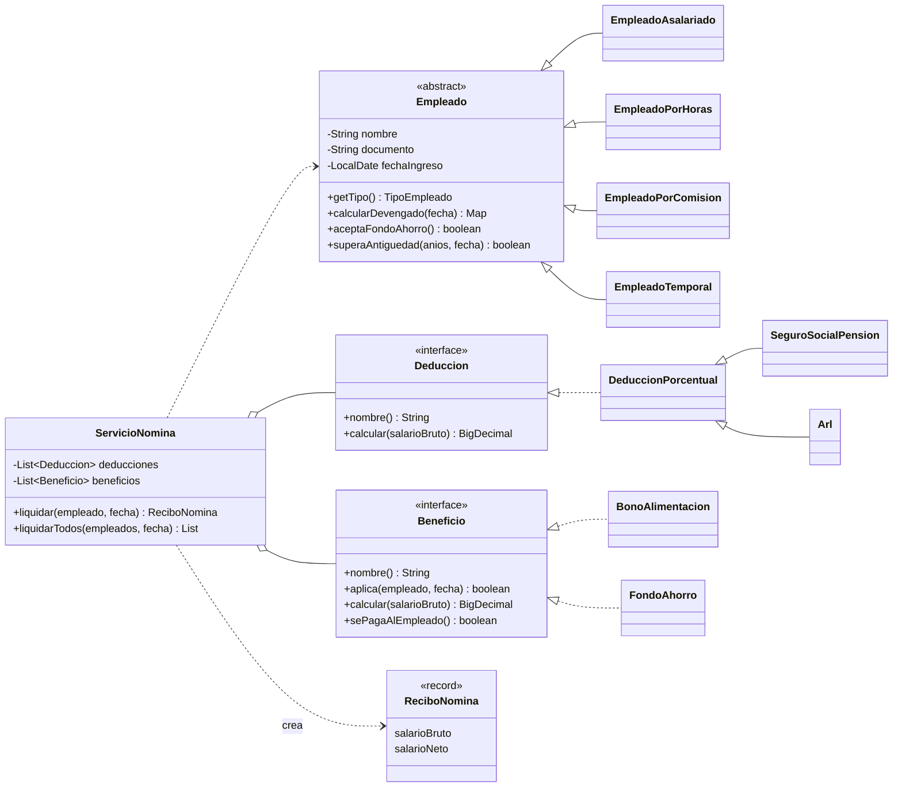

# Diagrama de clases

GitHub renderiza este diagrama automáticamente. Para exportarlo como **imagen PNG** (para el documento):
abre https://mermaid.live → pega el bloque de código → botón **Actions → PNG** → guarda en `capturas/diagrama_clases.png`.

